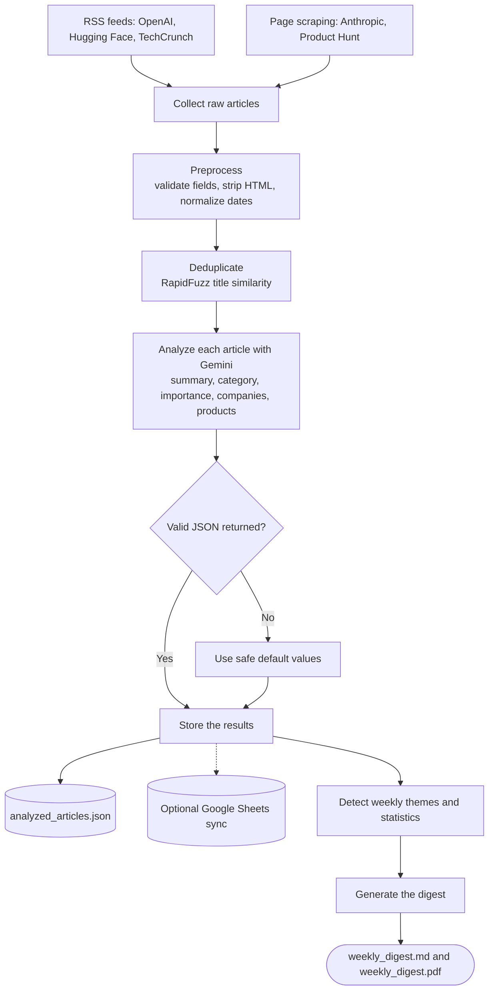

# 🚀 Newsletter Research Agent

An automated pipeline that gathers the week's AI news, removes duplicates, analyzes each story with Gemini, and produces a digest.

## 📌 Overview

Keeping up with AI news means reading dozens of sources. This agent collects articles from several sources, cleans and de-duplicates them, asks Gemini to summarize and categorize each one, detects the week's top themes, and writes a Markdown and PDF digest. A Streamlit dashboard lets you configure, run, and review everything.

## ✨ Features

* Collects from OpenAI, Hugging Face, and TechCrunch (RSS) plus Anthropic and Product Hunt (page scraping)
* Cleaning: schema validation, HTML stripping, date normalization
* Near-duplicate removal using RapidFuzz title similarity
* Gemini analysis: summary, category, importance, companies, products — with safe fallbacks if the AI call fails
* Weekly theme detection and statistics
* Markdown + paginated PDF digest (ReportLab) with wrapped table cells
* Optional, non-blocking Google Sheets sync
* Streamlit dashboard: configuration, run pipeline, view digest, analytics

## 🔄 Workflow

The weekly pipeline. A failing source or AI call is handled without stopping the run.



## 🛠️ Tech Stack

* Language: Python
* AI / LLM: Google Gemini (google-genai)
* Libraries: Streamlit, Pandas, Plotly, feedparser, BeautifulSoup, RapidFuzz, ReportLab, gspread
* Tools: Git, GitHub

## 📂 Project Structure

```
newsletter-research-agent/
├── app.py                  # Streamlit dashboard
├── main.py                 # CLI entry point
├── config/settings.py      # Settings loaded from .env
├── src/
│   ├── collectors/         # RSS + page scraping
│   ├── processors/         # preprocessing + deduplication
│   ├── agents/             # analyzer, theme agent, research agent (orchestrator)
│   ├── storage/            # JSON storage + optional Google Sheets sync
│   ├── generators/         # Markdown + PDF digest
│   └── utils/              # logger
└── requirements.txt
```

## ⚙️ Installation

1. Clone the repository:

```
git clone https://github.com/JAIMINRSOJITRA/newsletter-research-agent.git
```

2. Navigate to the project:

```
cd newsletter-research-agent
```

3. Install dependencies:

```
pip install -r requirements.txt
```

4. Create a `.env` file with your own settings (never commit it):

```
GEMINI_API_KEY=your_key_here
# optional
GEMINI_MODEL=gemini-2.5-flash
GOOGLE_SHEET_ID=
DUPLICATE_THRESHOLD=90
```

## ▶️ Usage

Run the dashboard:

```
streamlit run app.py
```

Or run the whole pipeline from the command line:

```
python main.py
```

The digest is written to `data/reports/weekly_digest.md` and `weekly_digest.pdf`.

## 📊 Results / Demo

* Verified stage by stage: preprocessing drops malformed entries and strips HTML, de-duplication catches near-identical titles, and digest generation produces both a Markdown file and a real PDF.
* Gemini calls fail soft: a bad response yields default values instead of crashing the run.

## 🧠 What I Learned

* Building resilient pipelines where one failing source or API call doesn't take down the whole run
* Getting structured JSON from an LLM and falling back safely when it isn't valid
* Migrating from a deprecated SDK (`google-generativeai`) to its replacement (`google-genai`)
* Making ReportLab tables wrap long text instead of overflowing the page

## 🔮 Future Improvements

* Schedule weekly runs (cron or GitHub Actions) and email the digest
* Complete Google Sheets setup with a service account
* Add tests for the page-scraping selectors, which depend on site layout

## 🤝 Contributing

Contributions, issues, and suggestions are welcome.

## 📄 License

This project is licensed under the MIT License.

## 👨‍💻 Author

Jaimin Sojitra

* GitHub: https://github.com/JAIMINRSOJITRA
* LinkedIn: https://www.linkedin.com/in/jaimin-sojitra-4683a1277/
